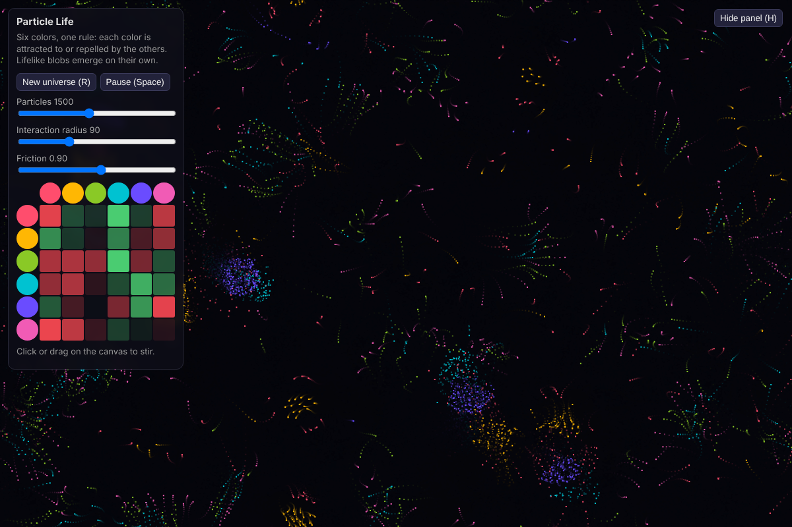

# Particle Life

Six colors of particles, one simple rule: each color attracts or repels every other color. From that, cells, worms and chasing swarms form on their own.

## Run it
Open `index.html` in any browser. No install, no dependencies.

## Controls
- **R**: new random universe (new rules)
- **Space**: pause
- **H**: hide the panel
- **Click/drag**: stir the particles
- **Rule matrix**: click a square to change how one color (row) feels about another (column). Green attracts, red repels.

## How it works
Each frame, every particle sums forces from neighbours within the interaction radius: strong repulsion up close (so particles don't overlap), then the rule-matrix attraction or repulsion further out. A spatial grid keeps it fast, and the world wraps around at the edges.
