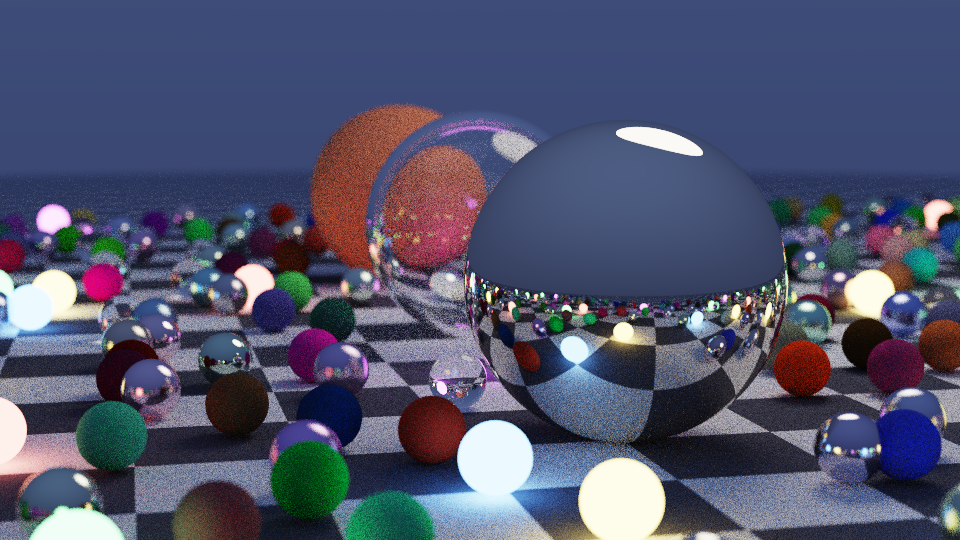

# Rust Path Tracer

A Monte Carlo path tracer in about 400 lines of Rust with **zero dependencies**. It renders physically based global illumination: soft shadows, colour bleeding, glass with refraction and Fresnel reflection, brushed and mirror metal, glowing emissive spheres, and lens depth of field. It writes the result as a PNG using its own encoder.



*960×540, 160 samples per pixel, 477 spheres, rendered in about 3.8 minutes on 2 cores.*

## Why it's interesting

- **Everything is built by hand.** That includes the vector maths, RNG (xorshift64\*), BVH, camera, materials, tone mapping and the PNG file format (zlib stored blocks, CRC-32, Adler-32). `Cargo.toml` has an empty `[dependencies]` section.
- **The lights are real light sources.** No light gets added separately. Light reaches the camera only when a random path bounces into an emissive surface, so soft shadows and coloured glow from the small light spheres come out naturally.
- **It uses unbiased tricks to stay fast.** Russian roulette ends weak paths early without biasing the result, and a bounding-volume hierarchy cuts each ray's work from hundreds of sphere tests to about log₂(n) box tests.

## Build & run

```bash
cargo build --release
./target/release/path-tracer --width 960 --spp 160 --out render.png
```

| flag | default | meaning |
|------|---------|---------|
| `--width`  | 960 | image width (height = width × 9/16) |
| `--spp`    | 128 | samples per pixel (more = less noise, slower) |
| `--depth`  | 16  | max bounces per path |
| `--seed`   | 42  | scene layout seed |
| `--out`    | out.png | output file |

Sample output:

```
scene: 477 spheres, 953 BVH nodes | 960x540 @ 160 spp, depth 16 | 2 threads
  done in 227.0s (0.37 M camera rays/s)
wrote screenshot.png
```

## How it works

1. **Scene.** It places a checkered ground sphere, three hero spheres (diffuse, mirror metal, and a hollow glass bubble made by nesting a negative-radius sphere) and an overhead area light. A seeded grid of small spheres is scattered around them with random materials.
2. **BVH.** Spheres are sorted along the longest axis of their bounding box and split in half, over and over. Traversal uses an explicit stack and keeps shrinking `tmax` as closer hits are found, so far boxes get skipped.
3. **Path tracing.** For each pixel sample, the thin-lens camera fires a jittered ray. At each hit, the material picks the next direction:
   - *Lambertian:* normal + random unit vector, which gives cosine-weighted sampling
   - *Metal:* reflection + fuzz
   - *Glass:* Snell's law, with Schlick's Fresnel approximation choosing between reflection and refraction, and total internal reflection handled
   - *Light:* returns its emission and ends the path
   The path's throughput is multiplied by each surface's albedo. After 4 bounces, Russian roulette may end the path.
4. **Parallelism.** Worker threads take rows from a shared `AtomicUsize` counter, so threads that finish early keep taking more rows.
5. **Output.** Radiance goes through the ACES filmic curve and gamma 2.2. Rows get PNG filter byte 0 and are wrapped in uncompressed deflate blocks. The CRC-32 and Adler-32 checksums are computed by hand.
