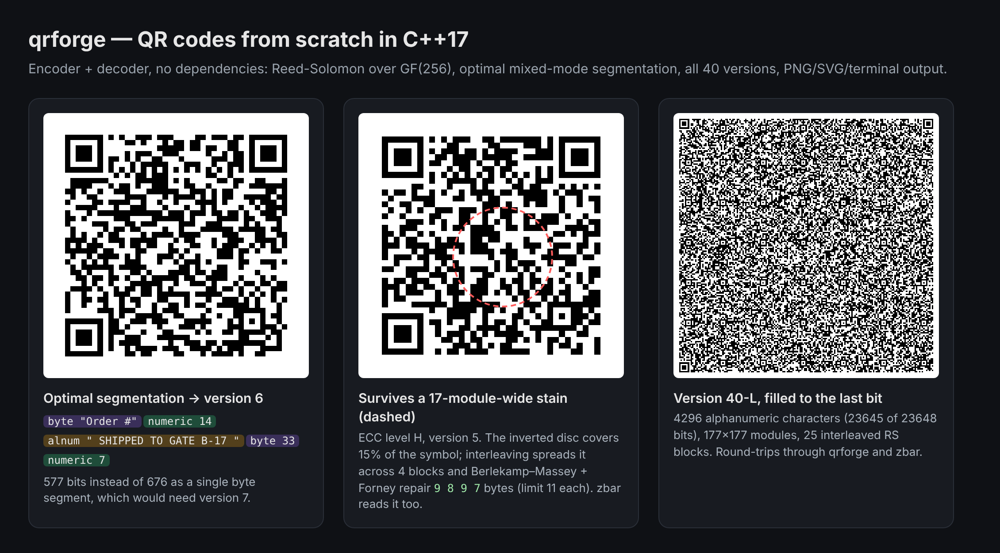

# qrforge: QR codes from scratch in C++17

qrforge is a QR code **encoder and decoder** in about 1,450 lines of C++17. It has no dependencies, not even zlib. It covers all 40 versions and all four error-correction levels (L/M/Q/H). It splits text into optimal numeric/alphanumeric/byte segments, picks the mask by the ISO penalty rules, and writes PNG, SVG or terminal output. The decoder reads PNGs, including ones made by other tools. It repairs damage with a real Reed-Solomon decoder (Berlekamp-Massey, Chien search and Forney), so it can read symbols with a big stain across them.



## Why it's interesting

- **Bit-identical to an independent implementation.** On 1,500 random symbols (every version, ECC level, mask and mode), the module matrix matches [python-qrcode](https://github.com/lincolnloop/python-qrcode) bit for bit.
- **It found a bug in segno.** Comparing against [segno](https://github.com/heuer/segno) 1.6.6 gave 638 mismatches. All of them happened when the data was already byte-aligned after the terminator. In that case segno's padding step does `8 - (length % 8)` and adds a needless zero byte. The test predicts exactly which symbols will hit this, and requires the other 862 to be identical. Both outputs scan; only the pad bytes differ.
- **Real error correction, tested to the limit.** `selftest` builds all 1,280 combinations of version, level and mask. In every Reed-Solomon block it damages exactly ⌊ecc/2⌋ codewords, the most that can be corrected, flipping random bits in each, and checks that all of them decode. It then adds one more error to one block and checks that the decoder never silently returns the original text.
- **Optimal segmentation.** A dynamic program over segment boundaries finds the shortest bit stream for each version. The example in the gallery mixes byte, numeric and alphanumeric runs. It needs 577 bits and fits in version 6. A single byte segment would need 676 bits and version 7.
- **Its own PNG codec.** The writer uses deflate with fixed Huffman codes and an LZ77 matcher with just two candidates: "same as the previous pixel" and "same as the row above". That makes QR images 47x smaller. The reader has a full inflate (stored, fixed and dynamic Huffman blocks), all five PNG filters, and every colour type, bit depth and palette/tRNS. Python's zlib accepts every PNG qrforge writes.
- **Checked against zbar too.** zbar reads every PNG qrforge writes, including mixed-segment and version-40 symbols. Copies damaged with random module flips are decoded by zbar and qrforge alike, and the two never disagree.

## Build and run

Needs a C++17 compiler (tested with g++ 13).

```sh
make
./qrforge encode "https://github.com/zediedsnow/daily-projects"        # prints to the terminal
./qrforge encode -e H -s 10 -o code.png "some text"                   # PNG (also .svg, .txt)
./qrforge encode --info -e Q -o mixed.png "Order #12345678901234 SHIPPED TO GATE B-17 via https://example.com/track?id=8675309"
./qrforge decode --info code.png
./qrforge damage code.png hurt.png --blot 20,20,8 --flip 10            # vandalise a symbol
./qrforge selftest
make test        # selftest + tests/crosscheck.py (needs: pip install segno qrcode; apt install zbar-tools)
```

Options for `encode`: `-e L|M|Q|H`, `-v N` or `-v N-M` (version range), `-m 0-7` (force mask), `--no-boost` (don't raise the ECC level when it fits in the same version), `--no-optimize` (single segment), `--matrix` (print 0/1 rows), `--info`.

## Sample output

```
$ ./qrforge encode --info -e Q -o mixed.png "Order #12345678901234 SHIPPED TO GATE B-17 via https://example.com/track?id=8675309"
version 6 (41x41), ECC Q, mask 2
data: 83 bytes -> 577 bits of 608 available (94.9% full), 4 blocks x 24 ECC codewords
  segment byte            7 chars  "Order #"
  segment numeric        14 chars  "12345678901234"
  segment alphanumeric   22 chars  " SHIPPED TO GATE B-17 "
  segment byte           33 chars  "via https://example.com/trac..."
  segment numeric         7 chars  "8675309"
mask penalties: 0:2066 1:1993 2:1855* 3:1973 4:2033 5:1868 6:2014 7:2134

$ ./qrforge damage stain.png stain-damaged.png --blot 20,20,8
$ ./qrforge decode --info stain-damaged.png
version 5 (37x37, 10.0 px/module), ECC H, mask 5, format bits off by 0
Reed-Solomon: corrected 33 bytes across 4 blocks (per block: 9 8 9 7, max 11 each)
  segment byte           44 chars
https://github.com/zediedsnow/daily-projects

$ ./qrforge selftest
reed-solomon: 20000 random codewords with 0..t errors corrected exactly
round trip: 1280 symbols (v1-40 x L/M/Q/H x 8 masks), each with the maximum correctable damage in every block: all decoded, 393696 codewords repaired
over the limit: 1280/1280 symbols with t+1 errors in one block were rejected or failed safely
ok (4.41 s)

$ python3 tests/crosscheck.py
python-qrcode: 1500/1500 random symbols (v1-40, L/M/Q/H, all 8 masks, numeric/alnum/byte) bit-identical
segno: 862 bit-identical, 638 differ exactly where segno's byte-aligned pad bug predicts, 0 unexplained
auto mask choice (informational, penalty details differ between libraries): python-qrcode agreed 1095/1500, segno 756/862
zbar:  500/500 qrforge PNGs (incl. optimal mixed-mode segments) decoded to the exact text
damage: random module flips worth half the ECC budget: qrforge recovered 495/500, zbar 495/500, disagreed on 0
ours:  300/300 segno PNGs (zlib, palette/transparent, scale 1-6) decoded to the exact text
all cross-checks passed in 354 s
```

(The 5 damaged symbols that neither decoder recovered had random flips that happened to pile up in one block, past its correction limit.)

## How it works

| File | What it does |
|---|---|
| `src/gf256.hpp` | GF(2⁸) with the QR polynomial 0x11D, using log/antilog tables |
| `src/reedsolomon.hpp` | Encoder (LFSR division by ∏(x−αⁱ)). Decoder: syndromes → Berlekamp-Massey error locator Λ → Chien search for the error positions → Forney for the error values, then a check that the syndromes are now zero |
| `src/qr.cpp` | ISO 18004 tables, segmentation DP, bit stream, block split and interleaving, function patterns, zig-zag placement, 8 masks, penalty rules N1–N4, BCH format/version codes. The decoder does all of this in reverse, finding the nearest valid format codeword within Hamming distance 3 |
| `src/png.cpp` | PNG writer (CRC-32, Adler-32, fixed-Huffman deflate) and reader (inflate, unfiltering, colour conversion, alpha composited onto white) |
| `src/main.cpp` | CLI, rendering (PNG / SVG with one path run per row / half-block terminal), the image sampler and the self-test |

**Encoding pipeline.** First the text is segmented. `cost[j] = min over i<j and modes m of cost[i] + 4 + countBits(m, v) + payloadBits(m, j−i)`, and the result depends on the version because count fields grow at versions 10 and 27. Then the smallest version that fits is chosen, and the ECC level is optionally raised if it still fits. Next come the mode and count headers, the terminator, zero padding to a byte and the alternating 0xEC/0x11 pad codewords. The data is split into blocks, Reed-Solomon ECC is added to each, and the blocks are interleaved. The bits are placed in two-column strips that snake up and down from the right edge and skip the timing column. Finally each of the 8 masks is applied with its format info and scored, and the one with the lowest penalty wins.

**Decoding pipeline.** The sampler finds the bounding box of the dark pixels. The top edge of the top-left finder pattern is 7 modules of dark, which gives the module pitch. Each module is sampled at its centre. The decoder reads both copies of the format info and BCH-decodes them, rebuilds the function-pattern map for the version, unmasks, reads the zig-zag and de-interleaves. It then runs Reed-Solomon correction on each block and parses the numeric, alphanumeric, byte and ECI segments.

**Why the stain survives.** Interleaving puts consecutive codewords in different blocks. A blob that covers ~33 neighbouring codewords therefore costs each of the 4 blocks only 7–9 errors, under the limit of 11.

**Limits.** The decoder expects an axis-aligned image, such as a screenshot or a generated file. It has no perspective correction for camera photos. Kanji mode, Structured Append and Micro QR are not supported.
