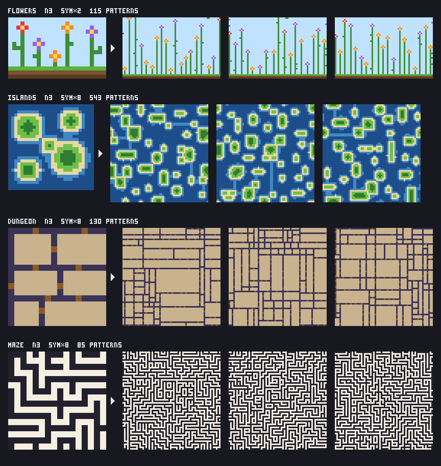
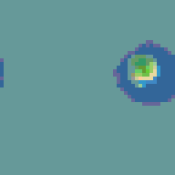

# loom: Wave Function Collapse in pure Lua

Give it a tiny bitmap drawn as ASCII art; it weaves arbitrarily large new images that look like the sample,
because **every 3x3 window of the output appears somewhere in the input**. This is Maxim Gumin's
[Wave Function Collapse](https://github.com/mxgmn/WaveFunctionCollapse) overlapping model, written from scratch
in Lua 5.4 with no libraries. Even the image output is home-made: a PNG writer with its own DEFLATE compressor,
and an animated-GIF encoder with its own LZW, so you can watch the collapse happen.





## Why it's interesting

WFC is a constraint solver dressed up as an image generator. Each output cell starts in a "superposition"
of every pattern from the sample. The solver keeps collapsing the cell it is *most certain about* (lowest Shannon
entropy) and propagating what that rules out to its neighbours, like a sudoku player who always fills in the most
constrained square first. The output gets local structure (coastlines ring every island, maze corridors never dead-end
into a wall at the wrong angle, flowers stand on the ground) without anyone writing a rule for it.

## Run it

Needs only Lua 5.4 (`apt install lua5.4`, `brew install lua`).

```sh
lua5.4 loom.lua samples/islands.txt                        # -> islands.png
lua5.4 loom.lua samples/maze.txt --size 96x64 --seed 42 --term   # also draws it in the terminal
lua5.4 loom.lua samples/islands.txt --size 48x48 --gif collapse.gif   # animate the collapse
lua5.4 loom.lua --gallery screenshot.png                   # the image above
lua5.4 test.lua                                            # property tests
```

Options: `--size WxH`, `--seed N`, `--out FILE`, `--scale K`, `--gif FILE`, `--frames N`, `--periodic true|false`, `--term`, `--quiet`.

### Real output

```
$ lua5.4 loom.lua samples/islands.txt
Islands: 543 patterns (N=3, symmetry=8), propagator density 0.6%
  64x64 periodic output, seed 1, 1 attempt(s)
  model 0.20s, solve 6.24s; 4096/4096 windows found in sample: VALID
  wrote islands.png

$ lua5.4 test.lua
flowers   115 patterns  propagator symmetric  12 seeds x {bounded}:         ok
islands   543 patterns  propagator symmetric  12 seeds x {periodic, bounded}: ok
dungeon   130 patterns  propagator symmetric  12 seeds x {periodic, bounded}: ok
maze       85 patterns  propagator symmetric  12 seeds x {periodic, bounded}: ok
84 generations, 59328 windows checked, 2 contradiction restart(s), 74.9s
ALL TESTS PASSED
```

The tests check, for every sample and many seeds, that every N x N window of the output really is one of the
sample's patterns, that a seed always gives the same image (the RNG is a built-in SplitMix64, so results don't depend
on the Lua build), and that the adjacency relation is symmetric. The PNG and GIF encoders were checked against
Pillow: the decoded final GIF frame matches the PNG pixel for pixel.

## Make your own sample

A sample is a text file: a header, colour declarations, `---`, then one character per pixel.

```
name: Maze
N: 3                  # pattern size (2-4 is typical)
symmetry: 8           # 1 = as drawn, 2 = + mirror, 8 = all rotations/reflections
periodic-input: true  # the sample wraps around at its edges
periodic-output: true # the output tiles seamlessly
ground: false         # true: the bottom N rows are a floor that must line the bottom of the output
size: 64 64           # default output size
color # #23202e
color . #f4efe1
---
###.#.###.#.###.
#.#...#...#.....
...
```

## How it works

| File | What it does |
|------|--------------|
| `lib/wfc.lua` | The solver. Extracts every N x N pattern (with up to 8 symmetries) and its frequency; builds the propagator `prop[dir][a] = {b : a and b agree where they overlap}`; runs observe/propagate. |
| `lib/png.lua` | PNG writer: CRC-32, Adler-32 and a DEFLATE compressor (LZ77 with hash chains, fixed Huffman codes). |
| `lib/gif.lua` | GIF89a encoder: variable-width LZW (9-12 bits, table reset at 4096), sub-blocks, looping animation. |
| `lib/font.lua` | 3x5 bitmap font for the gallery labels. |
| `lib/sample.lua`, `lib/rng.lua` | Sample-file parser; SplitMix64 PRNG. |

**Propagation uses AC-4 style support counting.** For every cell, pattern and direction we store how many patterns
in the neighbouring cell still support it. Banning pattern `a` in a cell only decrements the counters of the patterns
`a` was supporting next door; any counter that hits zero bans that pattern too, and the ban goes on a stack. So the
work is proportional to what actually changes, not to cells x patterns squared.

**Entropy is maintained incrementally.** Each cell keeps sum(w) and sum(w log w) over its surviving patterns, so
its Shannon entropy `log(sum w) - sum(w log w)/sum(w)` is updated in O(1) per ban. A tiny bit of noise breaks ties.

**The animation is free.** Every ban also subtracts that pattern's weighted colour from a running per-cell sum, so the
"blurry superposition" colour of an undecided cell is always one division away. The GIF palette is a 6x6x6 colour
cube for those blends, plus the sample's exact colours for decided cells.

**Contradictions** (a cell with no options left) are rare with these samples; the solver restarts with a new seed (2
restarts in the 84 test runs above).

**Grounded samples** (the flowers) pin the "ground" pattern to the bottom row of the output and ban it everywhere
else, then let propagation grow stems upward.
