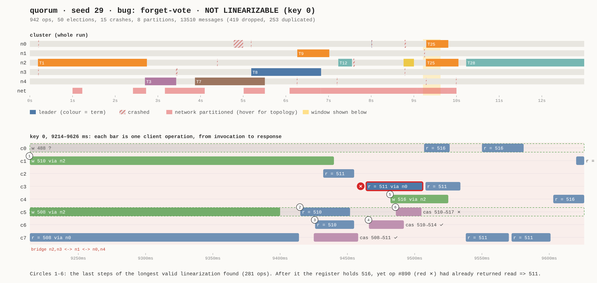

# quorum: a Jepsen for Raft, in OCaml

`quorum` is three things in about 1,500 lines of dependency-free OCaml:

1. **A Raft cluster.** It has leader election, log replication with conflict back-off, commit only for current-term entries, an election no-op, and client sessions that make retries idempotent. The cluster runs a replicated key/value store of registers that supports read, write and compare-and-set.
2. **A deterministic simulator with a nemesis.** Every message delay, drop, duplicate and reorder comes from one seeded PRNG, and so does every partition (halves, isolated leader, *bridge*, *majorities ring*), crash, kill-9 bounce and election timeout. FoundationDB-style "buggify" faults kill nodes at fragile moments, such as right after a vote or right after an election. Any run, including any bug it finds, replays exactly from its seed.
3. **A linearizability checker.** It uses the Wing & Gong search with Lowe's memoization, the algorithm behind Porcupine and Knossos, over a *nondeterministic* register model. That model is needed because a compare-and-set that timed out may or may not have happened. The checker returns either a witness order or the longest valid linearization plus the operation that cannot be placed.

The simulator also checks Raft's own invariants online: election safety, leader completeness and state-machine safety. You can switch on one of four realistic implementation bugs and watch both oracles catch them.



*Seed 29 with `--bug forget-vote`. Node n1 votes for n2 in term 25 and is killed by buggify. Because it restarts without its persisted vote, it votes again for n0. The top panel shows n0 and n2 as leaders of term 25 at the same time, connected through n1, which is the bridge node in a bridge partition. Below that is the key-0 history: client c3 reads 511 through n0 after writes acknowledged by n2 had already moved the register on to 516.*

## Why it's interesting

Distributed-systems bugs only show up under specific interleavings of failures, so normal tests almost never hit them. The Jepsen approach is to generate a lot of chaos, record what clients saw, and then check the whole history against a sequential specification. The simulation is deterministic, so the chaos is cheap, at about 70k client operations per CPU-second including checking, and a failure is never "flaky". Re-run the seed and add `--trace`.

Results from 1,000 seeds per configuration (13 simulated seconds each):

```
$ ./quorum sweep --seeds 1000 --bug all
bug                runs       ops nonlinearizable raft-invariant      cpu  first failing seeds
none               1000   1032298              0            0    15.0s
stale-reads        1000   1179765            593            0    14.6s  1 2 4 6 8
forget-vote        1000   1035337              4           27    14.3s  20 29 83 128 140
eager-truncate     1000    979643            150          531    15.6s  3 4 5 6 8
commit-old-term    1000   1037529              0            1    14.8s  798
```

- **Correct Raft** produced no false positives in a separate 3,000-seed sweep covering 3.1 million operations.
- **stale-reads** means the leader answers reads from local state without checking it is still leader. A leader cut off in the minority keeps serving old values, and the checker flags it in most runs.
- **forget-vote** means `votedFor` isn't persisted. It needs a crash at exactly the wrong moment *and* two candidates in the same term, so only about 3% of runs hit it.
- **eager-truncate** means a follower truncates on every AppendEntries. A reordered, stale AppendEntries silently erases committed entries.
- **commit-old-term** is the Raft paper's Figure 8 bug, with the no-op removed so it is reachable. It needs three leader changes with partially replicated logs in the right order and showed up once in 3,000 seeds, as seed 798. That rarity is why the paper gives it a whole figure.

## Build and run

You need OCaml ≥ 4.14 (`apt install ocaml-nox`). The project uses only the standard library.

```sh
make                 # builds ./quorum
make test            # checker self-test + a 50-seed sweep of every bug

./quorum run --seed 2 --bug stale-reads              # one run, report
./quorum run --seed 29 --bug forget-vote --svg r.svg # plus an SVG timeline
./quorum run --seed 29 --bug forget-vote --trace     # every election, vote, fault
./quorum sweep --seeds 1000 --bug all
./quorum selftest
./quorum bugs
```

Sample report:

```
$ ./quorum run --seed 2 --bug stale-reads
seed 2, bug: stale-reads, 5 nodes, 8 clients, 3 keys, 13.0 s simulated
  events 19494 | messages 11304 sent, 328 dropped, 209 duplicated
  nemesis: 6 partitions, 15 crashes | 20 elections, 8 leaders elected
  history: 1331 ops (618 reads, 399 writes, 314 cas) - 1331 ok, 0 indeterminate

Raft invariants (checked online):
  election safety, log matching, leader completeness, state machine safety: OK

Linearizability (Wing-Gong-Lowe search, per key):
  key 0:  444 ops  NOT LINEARIZABLE (0.000s)
    longest valid linearization covers 133 ops; its last few:
      #378   c5  [   2655 ..   2688 ms]  write 204 => ok         (answered by n4)
      #382   c4  [   2701 ..   2719 ms]  read => 204             (answered by n4)
      #384   c6  [   2709 ..   2739 ms]  write 209 => ok         (answered by n4)
      #390   c2  [   2746 ..   2778 ms]  write 210 => ok         (answered by n4)
      #396   c6  [   2779 ..   2811 ms]  write 215 => ok         (answered by n4)
    register is now 215, but this op had already returned and cannot be placed:
   >> #399   c3  [   2815 ..   2831 ms]  read => 175             (answered by n2)
```

In this run n2, the old leader, was isolated at 2.4 s while n4 took over in term 2. n2 kept answering reads with values from before the partition.

The checker is validated against an exhaustive permutation checker:

```
$ ./quorum selftest
  sequential write/read              expect true  checker true  brute force true  ok
  stale read after write             expect false checker false brute force false ok
  ...
  50000 random histories: 37716 linearizable, 12284 not; checker agrees with brute force on all but 0
```

## How it works

| file | what |
|------|------|
| `rng.ml` | SplitMix64 PRNG, the single source of nondeterminism |
| `pq.ml` | binary heap event queue ordered by (time, insertion order) |
| `raft.ml` | nodes, clients, network, nemesis, buggify, online invariant checks |
| `lin.ml` | linearizability checker + brute-force reference |
| `viz.ml` | SVG timeline: leaders/crashes/partitions + zoomed key history |
| `main.ml` | CLI: run, sweep, selftest |

**Raft.** Persistent state (`term`, `votedFor`, the log) survives crashes. Everything else is lost, including commit index, the state machine and client sessions, and gets rebuilt by replaying the log. Followers reply to a failed AppendEntries with a hint that skips over a whole conflicting term. Leaders commit index *N* only when a majority has it **and** `log[N].term == currentTerm`.

**Clients** pick a node and follow redirect hints. They retry another node after 150 ms and give up after 1 s. A write or CAS that gets no answer is recorded as *indeterminate*: its return time is ∞, so it may take effect at any later point or never. Retries are safe because the state machine keeps a per-client session (last command id and its result), which is the deduplication from §8 of the Raft paper. Without it, network-duplicated requests would apply twice, and the checker does catch that.

**The checker.** Each op has a call event and a return event, kept in a time-ordered doubly linked list. The search walks the list. At a call it tries to linearize the op now: it applies the op to the model, and if the pair (bitset of linearized ops, model state) is new, it unlinks the op and restarts from the head. Hitting a return means an already-completed op was never placed, so the search backtracks. The memo table turns an exponential search into one that takes milliseconds on histories of hundreds of ops per key. Model states are *sets* of values, so an indeterminate CAS can branch. Keys are independent, so each key is checked on its own, which is linearizability's locality property.

**Online invariants.** The simulator sees every node's state. It records the leader of each term, the first entry applied at each log index (with the term it was committed in), and whether each new leader holds every entry committed in an earlier term.
