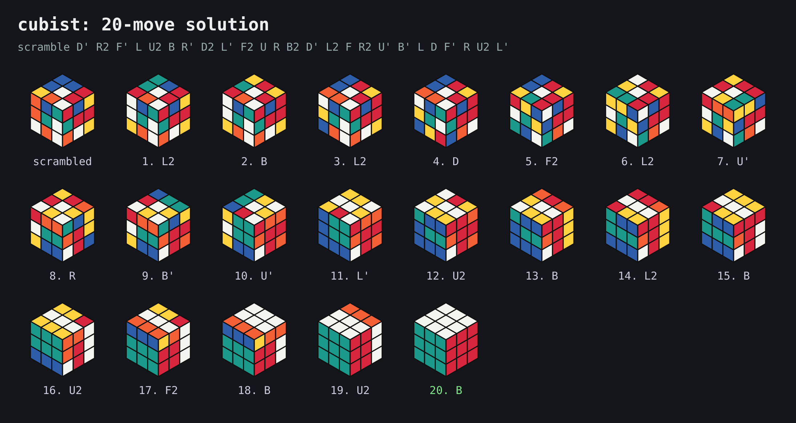

# cubist: a Rubik's cube solver with a built-in check for optimal solutions (C#)

`cubist` solves any legal 3x3x3 Rubik's cube in **20 moves or fewer**. A random cube takes about 17 ms (median). It's a from-scratch C# version of **Herbert Kociemba's two-phase algorithm**: cubie and coordinate models, move tables, BFS pruning tables, and six IDA* searches that run at the same time. It also has a **mode that proves its solution is optimal**. To check that mode, cubist includes a second solver that shares no code with it: a meet-in-the-middle search over all 8.2 million positions within 6 moves of solved. The two solvers agree on every test case.



*Around move 9 in the film strip, the cube enters the subgroup H: from then on the top and bottom faces show only white and yellow, and the remaining moves are just U, D and half turns.*

## Why it's interesting

- The cube has 43,252,003,274,489,856,000 states, so a plain search can't solve it. Kociemba's idea is to split the problem in two.
  - **Phase 1** moves the cube into the subgroup H = ⟨U, D, R2, L2, F2, B2⟩. H has 19.5 billion states. In H every corner and edge is oriented correctly and the four middle-slice edges are in the middle slice.
  - **Phase 2** solves the cube inside H using only those 10 moves.
  - Each phase is small enough that exact distance tables (from breadth-first search) give a strong heuristic.
- **The search is complete.** Phase 1 runs at depths 0, 1, 2, … and every phase-1 endpoint is finished by an exact phase-2 search. If the search runs until it has covered everything shorter than the best solution so far, that solution is optimal. The `--optimal` flag does this.
- **The optimal mode is checked by a second, unrelated solver.** `MeetInMiddle` works only with raw permutation arrays and a 67-bit exact state key. It enumerates the 6-move "ball" around solved, searches outward from the scrambled cube until it touches the ball, and gets the exact distance for anything up to 12 moves away.
  - On 200 random scrambles of up to 12 moves, both solvers return the same optimal length every time.
  - The ball itself matches the published counts of positions at each distance (OEIS A080601): 1, 18, 243, 3 240, 43 239, 574 908, 7 618 438.
- **The move definitions are checked against known cube facts:**
  - Every face turn has order 4.
  - `R U` has order 105, and `R U2 D' B D'` has order 1260 (the largest order of any element).
  - Michael Reid's 20-move sequence produces the superflip, and its facelet string matches Kociemba's reference character for character.
- **It handles real input.** You can enter any cube as 54 facelet characters in any six letters. Impossible cubes are rejected with the reason: a twisted corner, a flipped edge, or a swapped pair (parity).

## Build and run

You need the .NET 8 SDK (on Ubuntu: `apt install dotnet-sdk-8.0`). There are no NuGet dependencies, and the included `nuget.config` disables package sources so the build works offline.

```sh
dotnet build -c Release -o bin/out

./bin/out/cubist solve R U R\' U\' F2 D L2 B\'               # solve a scramble
./bin/out/cubist solve --facelets UBULURUFURURFRBRDRFUFLFRFDFDFDLDRDBDLULBLFLDLBUBRBLBDB   # superflip
./bin/out/cubist solve --optimal R U2 F\' L D2 B R\' U F2 D\' # prove the solution is optimal
./bin/out/cubist solve --svg out.svg <moves...>              # write a film strip like the one above
./bin/out/cubist scramble                                    # solve a uniformly random cube
./bin/out/cubist bench 1000                                  # statistics over random cubes
./bin/out/cubist audit 200                                   # two-phase optimal mode vs. meet-in-the-middle
./bin/out/cubist verify                                      # full self-test (28 checks, ~3.5 min)
```

In a terminal, the cube net is drawn in colour. Set `NO_COLOR` to print letters instead.

## Sample output

All numbers below are from a 2-vCPU cloud container. The full logs are in [`examples/`](examples/).

```
$ cubist solve D' R2 F' L U2 B R' D2 L' F2 U R B2 D' L2 F R2 U' B' L D F' R U2 L'
      B B R
      B U R
      D L U
L U F L B F R B D B D D
R L D L F U F R R F B U
B D L U L U L U D F D U
      F F B
      F D L
      R R R
solution (20 moves): L2 B L2 D F2 L2 U' R B' U' L' U2 B L2 B U2 F2 B U2 B
search: 79.9 ms (won by the R-L axis search), 179,917 phase-1 nodes, 718 phase-2 searches, 59,920 phase-2 nodes
verified: applying the solution leaves the cube solved
```

```
$ cubist bench 1000
verified: 1000/1000 solutions solve their cube
length distribution:
  15 moves:     1  #
  16 moves:     1  #
  17 moves:    11  #
  18 moves:    39  ##
  19 moves:   245  ##############
  20 moves:   703  ##########################################
mean length 19.64 moves
time per cube: median 17.07 ms, mean 40.48 ms, p99 332.92 ms, max 2829.87 ms
```

```
$ cubist audit 200
building meet-in-the-middle ball of radius 6...
  8,240,087 positions in 9.6s
        200/200 agree; optimum distribution 1:5 2:5 3:3 4:10 5:5 6:8 7:3 8:3 9:9 10:55 11:42 12:52; 4 scrambles had a shorter solution than the scramble itself
        mean time: two-phase (optimal mode) 38 ms, meet-in-the-middle 2805 ms
```

```
$ cubist solve --optimal R U2 F' L D2 B R' U F2 D' L2 B' U R
solution (14 moves, proven optimal): R' U' B L2 D F2 U' R B' D2 L' F U2 R'
```

## How it works

| File | What's in it |
|---|---|
| `src/Cube.cs` | The cubie model: 8 corners and 12 edges, each with a position and an orientation. Moves are permutation products. Also the coordinates (twist, flip, slice, Lehmer ranks), facelet conversion and validation. |
| `src/Tables.cs` | Move tables (coordinate × move → coordinate) and five pruning tables built by BFS: twist×slice, flip×slice, twist×flip, cornerPerm×slicePerm and udEdgePerm×slicePerm. All are built in about 1 s at startup. |
| `src/Solver.cs` | The two-phase IDA* search and `MultiSolver`, which runs six searches at once. |
| `src/MeetInMiddle.cs` | The independent optimal solver used for the audit. |
| `src/Render.cs` | The ANSI terminal net and the isometric SVG film strip. |
| `src/Verify.cs` | The self-test suite. |

**Coordinates.** Phase 1 only cares about:

- corner twist: 3⁷ = 2,187 values
- edge flip: 2¹¹ = 2,048 values
- which 4 of the 12 positions hold the middle-slice edges: C(12,4) = 495 values

Each of these is a small integer, so a move is one table lookup. The heuristic is the largest of three exact projection distances. For example, the twist×slice table stores, for each of its 1,082,565 entries, the exact number of moves needed to fix both parts at once.

**Phase 2** uses the corner permutation (8! values), the U/D-layer edge permutation (8! values) and the slice permutation (4! values), with the 10 moves that keep the cube inside H.

**Getting the phase-2 start state cheaply.** The phase-2 search needs the U/D edge permutation, which phase 1 doesn't track. Replaying the moves on the full cube at every phase-1 endpoint was the main bottleneck. Instead, cubist replays the phase-1 path on two small 11,880-state coordinates, one for where the four U-layer edges are and one for the four D-layer edges, then combines them. It also checks the corner permutation × slice permutation distance before starting phase 2, which rules out hopeless candidates without touching the cube.

**Six searches.** The solver looks at the cube along each of its three axes (by conjugating with a 120° rotation about the URF–DBL diagonal) and also looks at the inverse cube along each axis. These six searches have very different phase-1 search spaces. They run on separate threads, and the first one to reach the target length stops the others. Solutions are mapped back by conjugating each move. Running six searches reduced the slowest-case time by about 3×.

**Optimality.** After finding a solution of length L, the solver lowers its limit to L−1 and continues. Phase 1 has already covered all shallower depths with a larger limit, and phase 2 is exact for each phase-1 path. So when the search finishes without finding anything shorter, no solution shorter than L exists. For quick mode, phase 2 is capped at 10 moves, which is faster but drops this guarantee.

**Meet-in-the-middle.** This solver is independent of the two-phase code:

1. Run a level-by-level BFS from the solved cube using sorted, de-duplicated key arrays. A position at depth d can only repeat at depth d−1 or d−2, so only those two levels need checking.
2. Store all 8.2 million positions within 6 moves in an open-addressing hash table.
3. For a query, search outward from the scrambled cube at depth k = 1…6, in parallel over the first move. A position touched at depth k with stored distance d gives a solution of length k + d.

Take any optimal canonical path of length L ≤ 12, and the node at step L−6 is inside the ball. So the smallest k + d found is exactly the optimum.

## Limitations

- The superflip is the slowest case: about 7 s single-threaded, versus milliseconds for a typical cube. It is symmetric, so all six search directions are the same. Kociemba's production solver gets past this with symmetry-reduced phase-1 tables of 140 million entries, which cubist doesn't build.
- `--optimal` is practical up to about 14–15 moves. Proving optimality for arbitrary 18–20 move positions needs much larger pattern databases, such as Korf's corner database.
