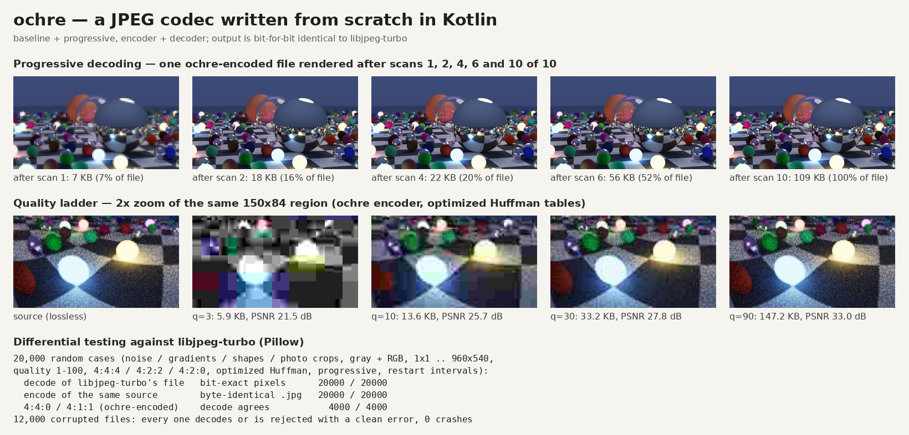

# ochre: a JPEG codec in Kotlin that matches libjpeg-turbo bit for bit

ochre is a JPEG **encoder and decoder** written from scratch in about 1,450 lines of Kotlin. It uses nothing but the JDK; `javax.imageio` is used only to read and write PNG files at the edges. It handles:

- **baseline and progressive** JPEG, both decoding and encoding: spectral selection, successive approximation, EOB runs and correction-bit buffering
- **4:4:4, 4:2:2, 4:2:0, 4:4:0 and 4:1:1** chroma subsampling, plus grayscale
- **restart markers**, the **standard Annex K Huffman tables**, and **optimal Huffman tables** built from symbol statistics
- an `info` mode that dumps markers, scan scripts, quantization tables and coefficient statistics, and a `scans` mode that saves a progressive file as it looks after each scan



## Why it's interesting

Most hobby JPEG codecs aim for "looks right". When you compare them with libjpeg, pixels usually differ by ±1 or ±2. The causes are a slightly different IDCT, different rounding in chroma upsampling, or a different color conversion. ochre aims for **exact** agreement instead, and gets it:

- **Decoder:** for any file it supports, ochre's output pixels are identical to what libjpeg-turbo produces through Pillow. That includes progressive files, odd sizes such as 1×1 or 33×7, and every subsampling mode.
- **Encoder:** with the same settings (quality, subsampling, optimize, progressive, restart interval), ochre writes a `.jpg` that is **byte-identical** to libjpeg-turbo's.

To get there, every arithmetic detail that libjpeg's output depends on is reproduced exactly:

- the 13-bit fixed-point "ISLOW" forward and inverse DCT (Loeffler–Ligtenberg–Moschytz), including the shortcuts for all-zero rows and columns and the 10-bit wraparound range-limit table
- the fixed-point YCbCr↔RGB tables
- the encoder's ordered-dither biases during downsampling (1,2,1,2 for 2×2 and 0,1,0,1 for 2×1), and edge replication done in the same order libjpeg does it
- the "fancy" triangle-filter upsampler, including its alternating +7/+8 and +1/+2 rounding and its replication of rows at the image edges
- the DC values of the dummy blocks that pad partial MCUs
- `jpeg_gen_optimal_table`, with its tie-breaking and its reserved all-ones code point
- the progressive scan script from `jpeg_simple_progression`, and the refinement-pass rule for folding ZRL runs into EOB runs
- the exact marker layout (which DHTs are written before which SOS, and where DRI goes)

## Build & run

You need a JDK (17 or newer) and `kotlinc` (tested with Kotlin 2.0.21).

```bash
./build.sh                                      # -> ochre.jar
java -jar ochre.jar encode photo.png out.jpg -q 85 --progressive
java -jar ochre.jar encode photo.png out.jpg -q 75 -s 444 --optimize --restart 8
java -jar ochre.jar decode out.jpg back.png      # or .ppm / .pgm
java -jar ochre.jar info out.jpg
java -jar ochre.jar scans out.jpg frame_         # frame_01.png ... one per progressive scan
tests/run.sh 2000                                # differential + corruption fuzzing (needs Python, Pillow, numpy)
```

## Sample output

```
$ java -jar ochre.jar encode examples/render.png examples/render-progressive.jpg -q 85 --progressive
examples/render-progressive.jpg: 111916 bytes (1.727 bpp), PSNR 31.83 dB, 570 ms

$ java -jar ochre.jar info examples/render-progressive.jpg
examples/render-progressive.jpg: 111916 bytes, 960x540, progressive, 3 component(s), 60x34 MCUs
  component 1: sampling 2x2, quant table 0, 120x68 blocks
  component 2: sampling 1x1, quant table 1, 60x34 blocks
  component 3: sampling 1x1, quant table 1, 60x34 blocks
markers:
  SOI
  APP0
  DQT
  DQT
  SOF2 960x540
  DHT
  DHT
  SOS comps=[1, 2, 3] Ss=0 Se=0 Ah=0 Al=1
  DHT
  SOS comps=[1] Ss=1 Se=5 Ah=0 Al=2
  ...
  SOS comps=[1] Ss=1 Se=63 Ah=1 Al=0
  EOI
...
nonzero coefficients: 176855 / 783360 (22.6%), 1.727 bits per pixel

$ tests/run.sh 5000 14
batch: 12000 ok, 0 failed
libjpeg-turbo 6.2 via Pillow; 5000 cases, seed 14, ochre batch time 10.2s
  decode bit-exact : 5000/5000
  encode identical : 5000/5000
  4:4:0/4:1:1 decode agrees with libjpeg-turbo: 1000/1000
corrupt: 2132 decoded, 9868 rejected cleanly, 0 crashed
```

Across seeds 1, 7, 11–14 and 99, the fuzzer has run more than **24,000 random cases** with no mismatches. ochre also decodes and encodes a 3840×2160 image in well under a second, including JVM startup.

`examples/render.png` is the path-traced image from [day 1's Rust path tracer](../2026-11-07-rust-path-tracer/).

## How it works

| file | what's inside |
|---|---|
| `Tables.kt` | zigzag order, the Annex K quantization and Huffman tables, IJG quality scaling, and the optimal 16-bit-limited Huffman table builder |
| `Dct.kt` | ISLOW forward DCT, and the inverse DCT with dequantization and range limiting |
| `Decoder.kt` | marker parser, a 64-bit bit reader that removes byte stuffing and stops at markers, a Huffman decoder with a 9-bit lookup table, and baseline, DC-first, DC-refine, AC-first and AC-refine block decoders with restart handling. Then IDCT, upsampling and color conversion |
| `Upsample.kt` | libjpeg-turbo's h2v1, h1v2 and h2v2 fancy upsamplers, with replication for all other ratios |
| `Encoder.kt` | color conversion, edge padding, downsampling, FDCT and quantization into a whole-image coefficient buffer. Entropy coding goes to one of two sinks: a counting sink that gathers statistics for optimal tables, or a bit sink that writes the file. Includes progressive EOB-run and correction-bit logic |
| `Main.kt` | CLI, PNM/PNG I/O, PSNR, a batch mode, and a corruption fuzzer |

**Decoding:** markers are parsed until SOS. Each scan's entropy-coded data is decoded into a per-component array of coefficients, kept padded to whole MCUs. Progressive scans keep refining that same array, so the `scans` command can render it at any point. At EOI, each block is dequantized and inverse-transformed into a sample plane. Chroma planes are then upsampled to full resolution and converted to RGB. JFIF, Adobe APP14 or component IDs decide whether the data is YCbCr or RGB.

**Encoding:** this is the decoder in reverse, plus one subtle requirement. Partial MCUs at the right and bottom edges are padded with "dummy" blocks whose AC coefficients are zero and whose DC is copied from a neighbouring block. Which neighbour is used affects the DC differences, and so the bytes written. When optimization is on, which progressive mode always requires, each scan runs twice. The first pass only counts symbols. Tables are then built from the counts, and the second pass writes the scan's own DHT and the scan data.

**Testing:** `tests/fuzz.py` generates random images: noise, gradients, overlapping shapes, crops of a photo-like render, flat colors, and gray versions of these. Sizes run from 1×1 to 960×540. Each image is encoded with random settings. ochre then decodes libjpeg-turbo's file and encodes the same source. The decoded pixels must match exactly, and the encoded bytes must match exactly. To show the fuzzer is actually sensitive, one rounding constant in the h2v2 upsampler was changed from +7 to +8. That single change made 65 of 300 cases fail. The `corrupt` command flips, overwrites and truncates bytes of valid files. Every result has to be either an image or a clean `JpegError`; no exceptions escape.

## Limitations

- 8-bit samples only.
- No arithmetic coding, lossless, or hierarchical JPEG.
- No CMYK or YCCK (4-component) images.
- No DNL marker.
- No EXIF orientation handling.
