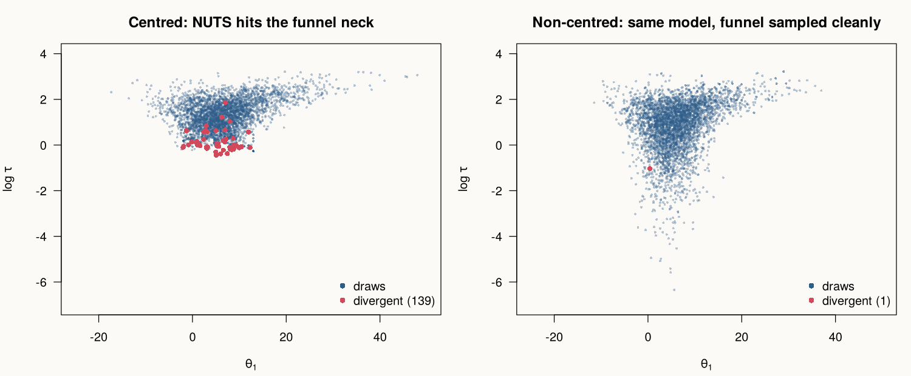

# nutmeg: a No-U-Turn Sampler in base R

nutmeg is a Bayesian inference engine written from scratch in about 650 lines of base R. It has three parts:

- a **vectorised reverse-mode autodiff** that hooks into R's own operators, so ordinary R arithmetic gives you gradients;
- **Stan's sampler**: multinomial NUTS with the generalised U-turn criterion, divergence detection, dual-averaging step size and windowed diagonal-metric adaptation;
- **modern convergence diagnostics**: rank-normalised split-R̂, bulk-ESS and tail-ESS, MCSE and E-BFMI.

You write a model as a plain R function. nutmeg handles the gradients, the constrained parameters and the sampling:

```r
source("nutmeg.R")
model <- nm_model(
  params = list(beta = real(3)),
  log_density = function(p, d)
    normal_lpdf(p$beta, 0, 5) + bernoulli_logit_lpmf(d$y, ad_vec(d$X %*% p$beta)),
  data = list(X = X, y = y))
fit <- nuts(model, chains = 4)
print(fit)
```
```
nutmeg NUTS fit of 'logistic regression': 4 chains x 1000 draws, 3 params
step sizes 0.786, 0.742, 0.737, 0.74 | mean tree depth 2.17 | 18916 leapfrogs | divergences 0 | 18.5s sampling CPU
   param   mean    sd     q5    q50    q95    mcse rhat ess_bulk ess_tail
 beta[1] -1.120 0.166 -1.400 -1.110 -0.851 0.00328    1     2590     2800
 beta[2]  0.695 0.171  0.412  0.695  0.981 0.00325    1     2760     2750
 beta[3]  1.400 0.186  1.110  1.400  1.720 0.00376    1     2440     2810

glm() maximum likelihood for comparison:
     X   Xage  Xdose
-1.105  0.684  1.384
```



*Eight schools, sampled by nutmeg. With the centred parameterisation, the sampler reports 139 divergent transitions, and they bunch in the neck of the funnel just as Stan's do. With the non-centred version it explores all the way down to log τ ≈ −6.*

## Why it's interesting

A sampler can produce believable but wrong numbers without any visible error, so this project spends most of its effort on proving the output is right. It uses four independent checks:

| Check | What it compares | Result |
|---|---|---|
| `tests/test_ad.R` | Gradients of 3,000 random expression trees (vector ops, recycling, `%*%`, indexing with repeats, `cumsum`, `lgamma`, `softplus`, …) against 4th-order finite differences, plus 900 transform log-Jacobians against numeric determinants | **0 failures**, Jacobian error ≤ 9.4e-9 |
| `tests/test_diagnostics.R` | R̂, bulk-ESS and tail-ESS on 1,000 random chain sets against the Stan team's `posterior` package | max relative difference **3e-14** |
| `tests/test_posteriors.R` | 7 models with known closed-form posteriors (normal-normal, beta-binomial via logit, gamma-Poisson via log, Dirichlet via stick-breaking, ρ=0.95 Gaussian, 50-d Gaussian with 100× scale range, Student-t₅) | means within **2.8** MCSE and sds within **2.7** SE, R̂ ≤ 1.006, 0 divergences |
| `tests/sbc.R` | Simulation-based calibration: 200 prior draws → simulated data → fit → rank of the truth | uniform ranks for all 3 params (χ² p = 0.75, 0.29, 0.76) |
| `tests/vs_stan.R` | Head-to-head with **Stan itself** (rstan 2.32) on eight schools, logistic regression and a Poisson varying-intercept model | all 24 parameters agree: max \|z\| 1.8 on means, 2.5 on variances |

The comparison with Stan also covers how the sampler behaves after adaptation, not only its answers:

```
                       step size (4 chains)          mean tree depth   leapfrogs/draw   divergences
eight schools  nutmeg  0.475 0.516 0.447 0.437       2.99              7.6              1
               stan    0.601 0.391 0.492 0.373       3.12              9.0              1
logistic       nutmeg  0.643 0.752 0.718 0.654       2.56              5.8              0
               stan    0.802 0.738 0.83  0.695       2.40              5.3              0
poisson-hier   nutmeg  0.131 0.117 0.109 0.113       4.37              31.1             0
               stan    0.104 0.108 0.0995 0.145      4.43              32.7             2
```

The tests also found real bugs during development. Two are worth describing:

- **Data generated in the wrong process.** R evaluates function arguments lazily, so `data = list(y = rnorm(20))` was first evaluated inside each forked worker, after its seed had been set. Every chain therefore fitted different data. R̂ caught it (1.23, with an ESS of 12).
- **Chains split twice in R̂.** The R̂ code split each chain into halves twice. The ESS values matched `posterior` exactly, but R̂ differed by up to 70%, and the differential test caught it.

## How to run

You need R ≥ 4.3, because `%*%` dispatch uses the `matrixOps` group generic. The core uses no packages.

```bash
Rscript examples/quickstart.R      # logistic regression vs glm()
Rscript examples/eight_schools.R   # the funnel; writes screenshot.png
./run_all.sh                       # the whole verification suite, ~25 min, logs in out/
```

Some tests need optional reference packages. The diagnostics test needs `posterior` and the Stan comparison needs `rstan`; on Debian/Ubuntu, install them with `apt install r-cran-posterior r-cran-rstan r-cran-bh`. Without them, those two tests are skipped. Chains run in parallel with `parallel::mclapply`; set `options(nutmeg.cores = n)` to change how many.

Parameter types: `real(n)`, `positive(n)` (log transform), `bounded(lo, hi, n)` (logit transform), `simplex(K)` (Stan's stick-breaking transform). Log densities: `normal`, `lognormal`, `cauchy`, `student_t`, `exponential`, `gamma`, `beta`, `dirichlet`, `bernoulli_logit`, `binomial_logit`, `poisson_log`. You can also write any log density yourself using R arithmetic.

## How it works

**Autodiff (`R/ad.R`).** An `adv` value is an immutable list holding the node's id, its value (a whole vector or matrix), its parent nodes and a backward closure. The S3 group generics `Ops`, `Math`, `Summary` and `matrixOps` record one node per *vector* operation, so a likelihood over 400 rows costs the same number of nodes as one over 4. R's recycling rules get a matching `unbroadcast` step that sums gradients back onto the operand that was recycled. Node ids increase monotonically, so the backward pass is a simple sweep over ids in descending order, which is already a topological order. Parents are discovered from the output, and nothing is ever written into a global tape array. An earlier version mutated a tape stored in an environment, which made R copy the lists, and it ran about 3× slower.

**NUTS (`R/nuts.R`).** Each transition draws a momentum and then doubles the trajectory forwards or backwards at random. `build_tree` recurses down to single leapfrog steps and returns each subtree's boundary momenta, summed momentum ρ and log-weight. A subtree is rejected if the generalised criterion `p♯₋·ρ > 0 ∧ p♯₊·ρ > 0` fails across the whole subtree, or across either of the two extra spans that straddle the merge point. Those extra checks are the fix Stan adopted for a U-turn hiding inside a merge. Within a subtree, points are chosen with multinomial weights e^−H. At the top level the choice is biased towards the new half, which favours moving far from the start. A leapfrog step whose energy error exceeds 1000 is marked divergent.

**Adaptation.** Warm-up follows Stan's schedule:

- a 75-iteration initial buffer;
- slow windows of 25, 50, 100, … iterations, each feeding a Welford variance estimate into a regularised diagonal metric `(n/(n+5))·var + 1e-3·5/(n+5)`;
- a 50-iteration final buffer.

Dual averaging (γ = 0.05, t₀ = 10, κ = 0.75, target acceptance 0.8) tunes the step size throughout. After each metric update the step size is re-initialised by the doubling/halving heuristic.

**Diagnostics (`R/diagnostics.R`).** These implement Vehtari et al. (2021). Draws are split into half-chains and rank-normalised to z-scores. R̂ is the larger of the bulk and folded (tail) versions. ESS uses FFT autocovariances truncated by Geyer's initial positive sequence and then made monotone. Tail-ESS is the smaller ESS of the 5% and 95% quantile indicators.

## Files

```
nutmeg.R               loader
R/ad.R                 reverse-mode autodiff on R's group generics
R/model.R              parameter transforms + Jacobians, log densities, nm_model()
R/nuts.R               NUTS transition, adaptation, multi-chain runner
R/diagnostics.R        R-hat, bulk/tail ESS, MCSE, E-BFMI, summary/print
tests/                 AD fuzzer, diagnostics diff-test, exact posteriors, SBC, Stan head-to-head
examples/              quickstart (logistic regression), eight schools
out/                   logs and CSVs from the last full run
```
