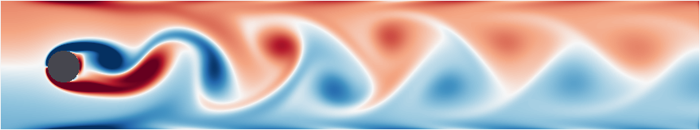

# karman — a lattice-Boltzmann CFD solver in plain Julia



*Vorticity behind a cylinder at Re = 100 (blue = clockwise, red = counter-clockwise),
144,320 cells, 40 per diameter. The animated version is [`vortex_street.gif`](vortex_street.gif) —
exactly one shedding period, so it loops seamlessly.*

`karman` is a 2D fluid solver written from scratch in about 900 lines of Julia with
**no packages at all** — not even for images. It simulates incompressible flow with
the lattice-Boltzmann method and is checked against the standard CFD validation case,
the DFG benchmark *"flow around a cylinder"* (Schäfer & Turek, 1996), which dozens of
finite-element and finite-volume codes have been compared on.

## Why it's interesting

Instead of solving the Navier–Stokes equations directly, lattice Boltzmann tracks
nine particle populations per cell that move to neighbouring cells and then
relax toward a local equilibrium. That's all it does, yet viscous incompressible
flow comes out: shear layers, boundary layers, and a von Kármán vortex street.
The hard part is the boundaries, and that's where most of this code goes:

* **Two-relaxation-time (TRT) collision.** Symmetric and antisymmetric parts of the
  populations relax at separate rates tied together by the "magic" parameter Λ.
  With Λ = 3/16 half-way bounce-back walls sit *exactly* midway between nodes, and
  the test suite checks that Poiseuille flow comes out exact to 1e-11.
* **Bouzidi interpolated bounce-back.** For every link that crosses the
  cylinder, the code works out where along the link the circle wall is (a
  ray/circle intersection), then interpolates the reflected population. That
  makes the curved wall second-order accurate rather than a staircase.
* **Momentum-exchange forces.** Drag and lift come from summing the momentum the
  populations carry into the wall and back out on every boundary link. No
  stress integration or surface mesh is needed.
* **Velocity inlet and pressure outlet.** The inlet is a moving-wall bounce-back
  with a parabolic profile, ramped in smoothly. The outlet uses anti-bounce-back
  at fixed density, with the velocity extrapolated from inside the domain.
* **A fused, threaded kernel.** Pull-streaming, boundary substitution and
  collision happen in a single pass over the grid, with populations stored as
  structure-of-arrays.
* **Its own image encoders.** An indexed PNG writer (CRC-32, Adler-32, zlib
  stored blocks, "Up" filter) and an animated GIF89a writer with variable-width
  LZW. The test suite round-trips the LZW through its own decoder.

## Results against the benchmark

Reference intervals are the ones published with the benchmark. Run on one core
of a 2.1 GHz Xeon.

**Test 2D-1, Re = 20 (steady flow):** reference cD = 5.5795, cL = 0.010619, ΔP = 0.11752

```
$ julia -t 1 karman.jl bench2d1 10 20 30 40
DFG 2D-1, Re = 20 (steady). Reference: cD ∈ (5.57, 5.59), cL ∈ (0.0104, 0.011), ΔP ∈ (0.1172, 0.1176)
    N    cells     steps      cD           cL            ΔP        time    MLUPS
   10     9020     33000   5.60919 out  0.010620 ok   0.11322 out     6.7s   43.8
   20    36080     56000   5.58677 ok   0.010634 ok   0.11584 out    46.5s   43.1
   30    81180     79000   5.57911 ok   0.010915 ok   0.11643 out   132.6s   48.0
   40   144320    102000   5.57722 ok   0.010899 ok   0.11672 out   305.9s   47.7
```

With 30 or more cells per diameter, drag is within 0.04% of the reference. Lift,
which is about 500 times smaller than drag and depends on the exact shape of the
wall, falls inside the published interval from N = 20 up. The pressure drop
converges toward 0.1175 and is 0.7% low at N = 40. It's read off a curved wall
by extrapolating from the nearest grid cells, so it's the hardest of the three
values to get right.

**Test 2D-2, Re = 100 (periodic vortex shedding):**

```
$ julia -t 1 karman.jl bench2d2 10 20 30 40
DFG 2D-2, Re = 100 (periodic). Reference: cDmax ∈ (3.22, 3.24), cLmax ∈ (0.99, 1.01), St ∈ (0.295, 0.305)
    N    cells     steps    cDmax        cLmax        St          periods   time    MLUPS
   10  diverged (tau = 0.5150 is too close to 1/2; use N >= 20)
   20    36080     48000   3.3169 out   0.9450 out   0.2992 ok      8      36.4s   47.1
   30    81180     72000   3.2543 out   0.9540 out   0.3004 ok      8     121.8s   47.6
   40   144320     96000   3.2538 out   0.9789 out   0.3004 ok      8     289.6s   47.4
```

The shedding frequency (Strouhal number 0.3004) lands in the middle of the
reference band. Peak drag is 0.5% above the band's upper end and peak lift 1%
below its lower end. I checked whether compressibility was the cause by halving
the Mach number (ū = 0.03 instead of 0.05 at N = 40): cDmax = 3.2484,
cLmax = 0.9807, St = 0.3013. Those barely moved, so the remaining gap comes from
spatial resolution near the cylinder and from the simple outlet, not from
compressibility.

## Test suite

```
$ julia -t 1 test/runtests.jl
    ny =  9  nu = 0.10   max rel. error 3.94e-12
    ny = 17  nu = 0.02   max rel. error 2.20e-11
    ny = 24  nu = 0.50   max rel. error 9.79e-13
    N =  16   L2 error 1.690e-02
    N =  32   L2 error 4.108e-03
    N =  64   L2 error 1.019e-03
    observed orders: 2.04, 2.01
    N = 10: cD = 5.6092  cL = 0.01062  ΔP = 0.1132
Test Summary: | Pass  Total   Time
Karman        |  101    101  16.4s
```

* **Poiseuille flow** in a force-driven channel matches the analytic parabola to
  about 1e-11 at three viscosities, which confirms the TRT wall-location result.
* **Taylor–Green vortex decay** converges at second order (2.04 and 2.01 under
  diffusive scaling).
* **Conservation:** in a periodic box, mass and momentum are conserved to
  machine precision. In a closed box with a Bouzidi cylinder, mass leaks less
  than 0.1%.
* **Geometry:** every Bouzidi wall point lies on the circle to within 1e-9.
* **Encoders:** CRC-32 and Adler-32 match their standard check values, and
  GIF LZW round-trips random, low-entropy and constant data.
* **A coarse 2D-1 run** finishes within 1% of the reference drag.

## Build and run

You need Julia (developed and tested on 1.13). It uses only the standard library modules Printf and Test, so there is nothing to install.

```bash
julia -t auto test/runtests.jl            # tests (~20 s)
julia -t auto karman.jl bench2d1 10 20    # steady benchmark at 10 and 20 cells/diameter
julia -t auto karman.jl bench2d2 20       # vortex shedding benchmark
julia -t auto karman.jl render 40         # writes screenshot.png and vortex_street.gif
```

## How it works

```
src/lattice.jl    D2Q9 constants, Sim state, boundary links, fused stream+TRT collide
src/geometry.jl   channel builder: walls, inlet, outlet, circle/link intersection (q)
src/benchmark.jl  DFG 2D-1 / 2D-2 setups, cD/cL/ΔP/Strouhal measurement
src/images.jl     PNG + animated GIF encoders, diverging colour map
karman.jl         command-line driver
test/runtests.jl  analytic, conservation and encoder tests
```

Each time step runs in two phases:

1. **Boundary links.** The geometry builder records every population that would
   be pulled from outside the fluid: from a wall, the inlet, the outlet or the
   cylinder. Each step, each of those links gets a value from its rule
   (bounce-back, Bouzidi, moving wall or anti-bounce-back), using the previous
   step's post-collision populations. The momentum exchange on cylinder links
   is summed into the force at the same time.
2. **Fused sweep.** For each fluid cell, the code pulls the nine populations
   from its neighbours and swaps in the link values on boundary cells (links are
   sorted by cell, so each cell finds its own with one lookup). It then computes
   density and velocity and relaxes symmetric/antisymmetric pairs toward
   equilibrium.

Units: with cylinder diameter N cells and mean inflow speed ū in lattice units,
the viscosity is ν = ū·N/Re, and one unit of physical time is 1/(Δx·ū) steps.
cD = 2F<sub>x</sub>/(ū²N), and St = N/(period·ū).

Reference: M. Schäfer, S. Turek, *Benchmark computations of laminar flow around
a cylinder*, Notes on Numerical Fluid Mechanics 52 (1996), 547–566.
