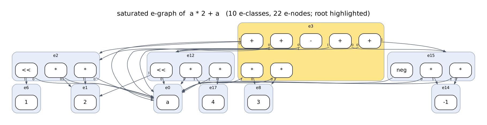

# saturn: an e-graph equality saturation engine in Scala 3

An e-graph equality saturation engine written from scratch in Scala 3 with no dependencies. It is modelled on [egg](https://egraphs-good.github.io/) and has hashconsing, a union-find, deferred congruence-closure rebuilding, a constant-folding e-class analysis, e-matching, a backoff rule scheduler and cost-based extraction. It uses all of that to simplify integer expressions, strength-reduce multiplications into shifts and prove algebraic identities. Every layer is checked against an independent oracle.



*The saturated e-graph for `a * 2 + a`. Each rounded box is an e-class: a set of expressions proved equal. The highlighted root class holds `a*2 + a`, `a + a*2`, `(a << 2) - a`, `a*3`, `3*a` and more, all stored at once. The extractor then picks the cheapest, `a * 3`.*

## Why it's interesting

A normal rewriting optimizer applies rules one at a time, and each rewrite destroys the term it came from. The order you apply rules in therefore changes the result (the *phase-ordering problem*). Equality saturation never destroys anything. Every rewrite only adds an equality to an **e-graph**, a compact structure that can represent exponentially many equivalent expressions in polynomial space. Rules keep firing until nothing new can be learned (*saturation*) or a budget runs out. Only then is the best expression extracted. Recent compiler optimizers, the Herbie floating-point tool and the Cranelift JIT's mid-end are built on this idea.

The hard part is keeping the data structure correct. When two e-classes merge, every expression that uses them may become congruent to another one (if `a ≡ b`, then `f(a) ≡ f(b)`). That has to be detected and repaired, and constant facts have to flow upward through the graph. saturn does this the way egg does, with a *deferred rebuild*. The test suite then checks the result from several independent directions.

## Build and run

You need a JDK (17+) and Scala 3 (`scalac`; tested with 3.5.2).

```bash
./build.sh                      # -> saturn.jar (the Scala runtime is bundled, so it runs with plain java)
java -jar saturn.jar demo
java -jar saturn.jar simplify "(x << 3) + (x << 1) - 10 * x + y * (3 - 2)"
java -jar saturn.jar simplify "x * 15" --cost latency
java -jar saturn.jar prove "(x + 1)^3 = x^3 + 3*x^2 + 3*x + 1"
java -jar saturn.jar dot "a * 2 + a" --iters 9 | dot -Tpng -o egraph.png
java -jar saturn.jar test        # full verification suite (~40 s)
java -jar saturn.jar bench       # 500-term obfuscation-recovery benchmark
```

Without `build.sh`, `scala run src -- demo` (scala-cli) also works.

The syntax uses integers, identifiers, `+ - * << ^` (C-like precedence, so `<<` binds loosest), unary `-` and parentheses. Arithmetic is exact (`BigInt`).

## Sample output

```
== simplification (cost = AST size) ==
  a * 2 + a * 6 - (8 * a - b)                    ==> b
  (x + 0) * (1 * y) + (x - x) * 1000             ==> x * y
  (a + b) * (a - b) + b ^ 2 - a ^ 2 + c          ==> c
  (x << 3) + (x << 1) - 10 * x + y * (3 - 2)     ==> y
  -(-(a * (b + c))) - a * c                      ==> a * b
  (2 + 3) * (x ^ 2 * x) - x ^ 3 * 4              ==> x ^ 3

== strength reduction (cost = ALU latency: mul 4, add/sub/shl 1) ==
  x * 15                 ==> (x << 4) - x           latency 4 -> 2
  x * 9                  ==> (x << 3) + x           latency 4 -> 2
  x * 64 + x * 8         ==> (x << 6) + (x << 3)    latency 9 -> 3
  y * 31 - y             ==> (y << 5) - y - y       latency 5 -> 3

== proofs by saturation ==
  PROVED     (a + b)^2 = a^2 + 2*a*b + b^2             8 iterations,     89 e-nodes,     1 ms
  PROVED     (x + 1)^3 = x^3 + 3*x^2 + 3*x + 1        22 iterations,   3110 e-nodes,   215 ms
  PROVED     (x + y)*(x - y) + y*y = x*x               8 iterations,    260 e-nodes,     4 ms
  not proved (a + b)^2 = a^2 + b^2                    12 iterations,     79 e-nodes,     1 ms
```

The last line is the engine *saturating*. It has derived every equality its rules can reach in that e-graph, and the two sides never meet. The test suite also finds a numeric counterexample for each false claim.

## Verification (`java -jar saturn.jar test`)

```
    20000 random terms print -> parse back to the identical tree
    3000 random e-graphs, 478383 term pairs: equivalence identical to naive congruence closure (12540 merged pairs)
    3200 (pattern, e-graph) searches agree with exhaustive enumeration (2620 matches)
    300 random terms saturated; 3600 extracted-vs-original evaluations equal
    1522089 e-node evaluations audited across whole e-graphs: every e-class denotes exactly one integer
    bogus rule 'a*(b+c) -> a*b + c'       caught on random term #1 by semantic audit
    bogus rule 'a - b -> b - a'           caught on random term #1 by semantic audit
    bogus rule 'a << k -> a * k'          caught on random term #1 by semantic audit
    bogus rule 'a^n -> a*n (n const)'     caught on random term #1 by semantic audit
    proved   ... 18 identities;  refuted ... 5 non-identities (with counterexamples)
    200 obfuscated terms: mean size 29.3 -> 4.6 (hidden original 4.6); recovered to <= original size in 200/200 (100.0%)
ALL CHECKS PASSED
```

What each check means:

* **Congruence closure vs. an oracle.** The test builds random ground terms and performs random unions. It then compares the e-graph's equivalence relation, pair by pair, against a naive "repeat until nothing changes" congruence-closure algorithm. It also checks the structural invariants: the hashcons is canonical, no node sits in two classes, parent edges are complete and the analysis is up to date.
* **E-matching vs. brute force.** For each pattern and small e-graph, every possible assignment of pattern variables to e-classes is enumerated. The matcher must find exactly the same set of matches.
* **Whole-e-graph semantic audit.** This is the strongest soundness check. Under a concrete variable assignment, every e-class must denote one single integer. The audit computes a value for each class and then re-evaluates *every e-node in the graph*: 1.5 million of them. If any node disagrees with its class, some rewrite was unsound.
* **Mutation testing.** Four subtly wrong rules are injected one at a time. Each is caught immediately, so the audit really does detect unsound rules.
* **Optimization benchmark.** A random term is simplified, then buried under 4–8 random meaning-preserving obfuscations (`t + 0*y`, `(t + c) - c`, `--t`, `(t<<1) - t`, `t * y^0`, re-distribution …). The optimizer has to dig the original back out, and it does on 500/500 terms in `bench`.

## How it works

| File | What's in it |
|---|---|
| `Term.scala` | Operators, exact semantics, a precedence-aware printer, and a Pratt parser (round-trip tested) |
| `EGraph.scala` | E-nodes, e-classes, union-find (path halving + union by size), hashcons, `add`/`union`/`rebuild`, constant-folding analysis, invariant checker, Graphviz output |
| `Rewrite.scala` | S-expression patterns (`(* ?a (+ ?b ?c))`), backtracking e-matching with an operator index, conditional and dynamic rewrites |
| `Rules.scala` | 29 rules: ring axioms, power laws, shift laws, analysis-driven strength reduction (`a*c → (a<<k) ± a` when `c = 2^k ± 1`), plus 4 deliberately bogus ones for mutation testing |
| `Runner.scala` | Saturation loop with egg's backoff scheduler, and bottom-up fixed-point extraction under a cost model (`size` or `latency`) |
| `Verify.scala` | Random generators, the obfuscator, the semantic audit and all the test suites |

**Rebuilding.** `union` doesn't restore congruence straight away. It records the merged class's parent e-nodes on a worklist. `rebuild()` then re-canonicalizes each one and looks it up in the hashcons. If the canonical form already lives in another class, the two are congruent and get merged, which may queue more work. Batching all repairs once per iteration is what made egg fast.

**E-class analysis.** Each class carries `Option[BigInt]`, its value if it's constant. `make` folds a node from its children's facts, `merge` joins two facts (and throws `UnsoundMerge` if two classes claimed to be equal hold different constants), and `modify` adds the literal to the class. Facts propagate upward through a second worklist. Once a class is known to be constant, its operator nodes are pruned, which stops `0 = 0*x = x - x = …` from swamping e-matching. The analysis also powers conditional rules such as "`x * c → x << log2 c` when `c` is a power of two".

**Scheduling.** Commutativity and associativity can grow the graph exponentially. The backoff scheduler bans any rule that produces more than `limit · 2^k` matches in one iteration, for `5 · 2^k` iterations, where `k` counts how many times that rule has been banned. Without it, assoc/comm would starve the useful rules. If nothing changed but some rules are banned, the bans are fast-forwarded. The run stops only when the graph is truly saturated, the goal is reached, or a node, iteration or time limit is hit.

**Extraction.** A fixed-point pass computes the cheapest node for each class (`cost(op) + Σ cost(children)`). Because every operator costs at least 1, the chosen nodes always form a finite tree, even though the e-graph itself is full of cycles (`x = x + 0`).
