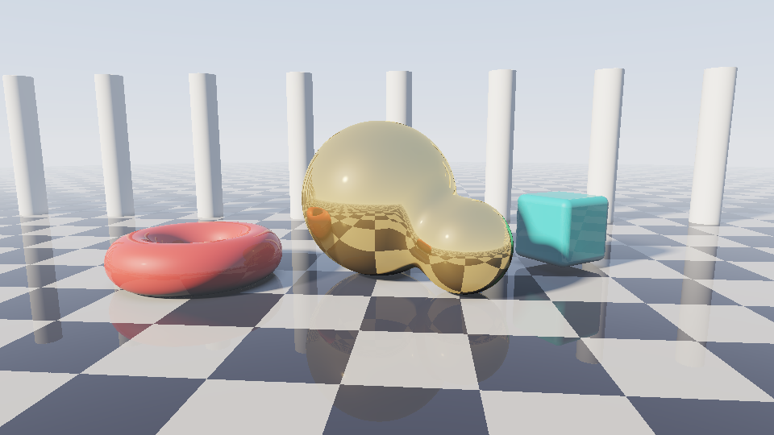

# umbra: a ray marcher written in SQL

umbra renders a 3D scene inside PostgreSQL and writes it out as a PNG. The renderer and the PNG encoder are both plain SQL: `LANGUAGE sql` functions, recursive CTEs, window functions and joins. It uses no PL/pgSQL, no extensions and no host language. The only thing that leaves the database is the finished file.



*960×540, rendered by `psql -f render.sql` in 4.5 minutes on 2 cores. Signed-distance-field geometry (a smooth-union blob, a torus, a rounded box and an infinite colonnade), soft shadows, ambient occlusion, Fresnel reflections up to two bounces deep, fog and ACES tone mapping. The PNG is compressed by a DEFLATE encoder written in SQL.*

## Why it's interesting

A ray marcher is normally a loop over pixels that contains another loop over steps. SQL has no loops, so umbra turns the problem around: **each ray is a row, and the whole image marches together.** One iteration of a recursive CTE moves *every* live ray forward by one safe step. That makes the image about 170 relational "wavefronts" instead of half a million separate loops. Rays that hit something, or escape, stop producing rows. Reflections work the same way: every reflective hit inserts a new row into the next generation's ray table, and that generation is traced as one more set-based pass.

The PNG encoder works the same way, which is less obvious:

* **PNG filters.** Every scanline is filtered five ways (None, Sub, Up, Average, Paeth) with `lag()` window functions. A `GROUP BY` picks the cheapest filter per row using the libpng heuristic.
* **LZ77.** Runs of equal bytes are found in one pass with the "gaps and islands" trick (`i - row_number() over (partition by v order by i)`). Each run becomes a literal plus distance-1 back-references of up to 258 bytes.
* **Huffman bit packing.** Tokens get fixed-Huffman codes from a 288-row lookup table. A running `sum() over (order by …)` gives every token its bit offset. The tokens are then split into single bits, and the bits are regrouped into bytes with `GROUP BY offset / 8`.
* **Adler-32** has a closed form, `B = n + Σ (n − i)·vᵢ`, so it is a single aggregate.
* **CRC-32** really is sequential. It is a recursive CTE that carries the 32-bit register from one byte to the next, using a 256-entry table that is itself built by a recursive CTE.

Getting this to run fast took some PostgreSQL detective work, and the fixes are commented in the code:

* **Inlining.** The scene SDF is written as single-row set-returning SQL functions with FROM-less `LATERAL` chains. The planner inlines that shape, so `EXPLAIN` shows the scene as plain arithmetic on the ray rows, not as a function call.
* **Optimisation fences.** Inlining has a cost: PostgreSQL has no common-subexpression elimination, so it pasted the entire SDF into each of the four places the step logic used it. A strategically placed `OFFSET 0` stops that and made tracing 2.7× faster.
* **Detoasting.** Calling `get_byte()` on a large bytea parameter decompresses the whole value on every call. Materialising a copy once took Adler-32 on 100 KB from 24 s to 45 ms.
* **Wide sort rows.** In one plan, a sort carried that 1.5 MB bytea along with each of its 1.5 M rows and spilled **29 GB** to disk. One `MATERIALIZED` CTE fixed it.
* **JIT.** At these plan costs, JIT compilation took 700 ms per call. It is switched off.

## Run it

You need PostgreSQL 14 or newer and a database you can connect to with `psql`. Developed and tested on PostgreSQL 16.

```bash
psql -f render.sql                                     # 960x540 -> umbra.png  (~4.5 min)
psql -v w=480 -v h=270 -v out=small.png -f render.sql  # quicker preview       (~1 min)
psql -v bounces=0 -f render.sql                        # no reflections
tests/run.sh                                           # all tests (~40 s; Python + Pillow for the PNG half)
```

`render.sql` (re)creates everything it needs in a schema called `umbra`.

## Sample output

```
== pass 0: sphere tracing
Time: 46783.955 ms (00:46.784)
== pass 0: soft shadows
Time: 63083.362 ms (01:03.083)
...
== statistics
 pass |  hits  | misses | wavefronts | sdf_steps
------+--------+--------+------------+-----------
    0 | 360226 | 158174 |        174 |  10835156
    1 | 109536 | 205473 |        200 |  10403420
    2 |  26701 |  29699 |        200 |   1479510
 png_bytes | raw_bytes | pct
-----------+-----------+------
    393357 |   1555200 | 25.3
wrote umbra.png
```

Pass 0 holds the camera rays, and passes 1 and 2 hold the reflections. The three tracing passes alone take 22.7 million SDF evaluations, before any shadow rays, normals or ambient occlusion probes. The PNG is 25% of the raw pixel size. That is about 2.6× larger than zlib's best effort, because umbra uses fixed Huffman codes and only finds runs, but `pngcheck` and every decoder accept it.

## Tests

`tests/run.sh` runs two suites:

```
1. scene() is 1-Lipschitz (sphere tracing never oversteps) on 50,000 random point pairs
 pairs | max_slope | result
 50000 |  0.999970 | PASS
2. analytic distances                                    5 × PASS
3. 3,000 random camera rays: every hit is within the stopping tolerance, and no ray tunnels through one
 hits | misses | worst_residual | result
 2268 |    732 |       0.015788 | PASS
 samples | inside_samples | result
 2416100 |              0 | PASS
4. soft shadows: occluded point is dark, open floor is lit     2 × PASS
crc32 + adler32: 400 inputs checked against zlib
deflate: 374 streams inflate back exactly (562184 -> 343558 bytes)
png_encode: 60 images decode pixel-exact in Pillow, all pass pngcheck
FAILURES: 0
```

* `tests/test_scene.sql` is itself written in SQL. The Lipschitz test matters most: sphere tracing is only correct if the distance field never overestimates. The test checks that the slope between nearby random points never exceeds 1. The tunnelling test then walks 300 traced rays in 2 mm steps up to where they stopped, and checks that none of them passed through a surface on the way.
* `tests/test_png.py` is differential. It compares CRC-32 and Adler-32 against `zlib`, inflates every DEFLATE stream with `zlib.decompress`, and decodes every PNG with Pillow to compare pixels exactly. The inputs include edge cases: empty input, single bytes, runs of exactly 258/259/260/261 bytes, white noise, and images 1 pixel wide or 1 pixel tall.

## How it works

| File | What it holds |
|------|---------------|
| `umbra.sql` | The scene SDF, `trace()` (sphere tracing), `shadow()` (penumbra estimate), tone mapping, CRC-32, Adler-32, `deflate()` and `png_encode()` |
| `render.sql` | Builds the camera rays, runs up to three passes, composes the passes, encodes the PNG and writes the file |
| `pass.sql` | One ray generation: trace, normals, materials, shadows, AO, lighting, and spawning reflection rays |

1. **Camera.** `generate_series` × `generate_series` produces one row per pixel with a look-at camera's ray direction.
2. **Sphere tracing.** `trace(pass)` is a recursive CTE over `(id, origin, dir, t, n, st)`. Each step evaluates the SDF once and then either stops (`d < 0.0004·(1+t)`), escapes (`t > 40` or 200 steps) or advances by `d`.
3. **Surface.** Normals use tetrahedral central differences (4 SDF probes instead of 6). The material is whichever object's distance is smallest.
4. **Soft shadows.** A second recursive CTE marches from each hit point towards the sun and keeps `min(k·h/t)`, which gives penumbrae for free (Quilez).
5. **Lighting.** Five SDF probes along the normal give ambient occlusion. The sun, sky dome and ground bounce are combined with Blinn-Phong highlights, Schlick Fresnel and distance fog.
6. **Reflections.** A reflective hit adds `w·(1−k)·colour` to its pixel and inserts a reflected ray of weight `w·k·tint` for the next pass. The final pixel is `SUM()` over all passes, `GROUP BY id`.
7. **Encode.** The ACES curve and gamma give 8-bit RGB, and `png_encode(w, h, rgb)` produces the PNG. psql cannot write raw bytes, so the file leaves as base64 and is piped through `base64 -d`.
